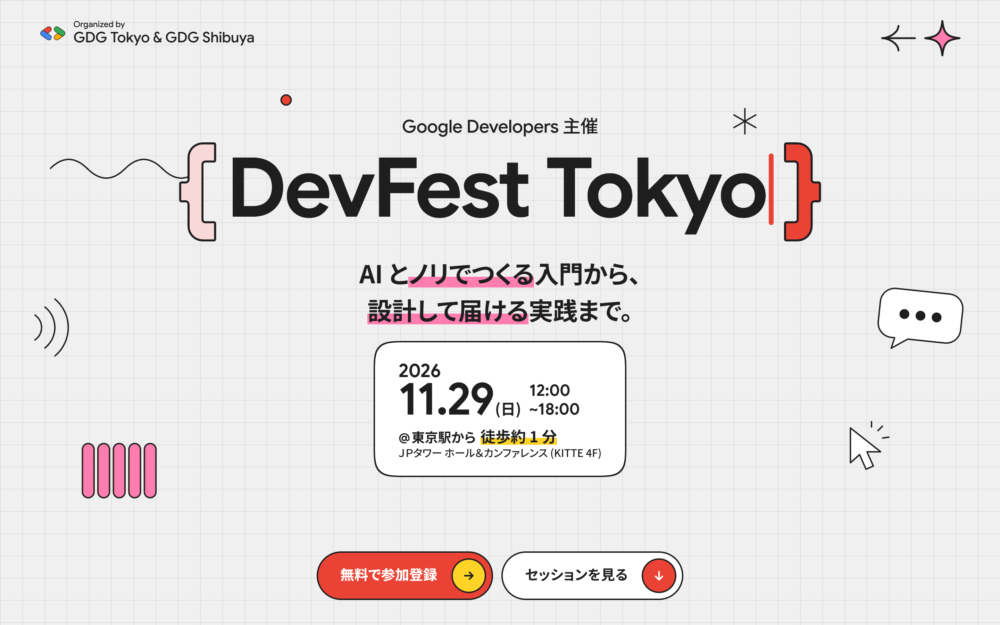
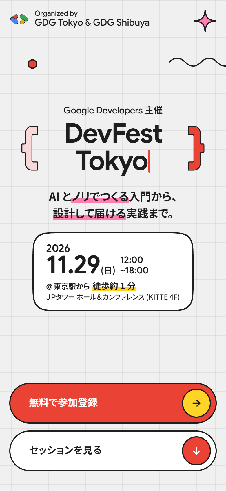
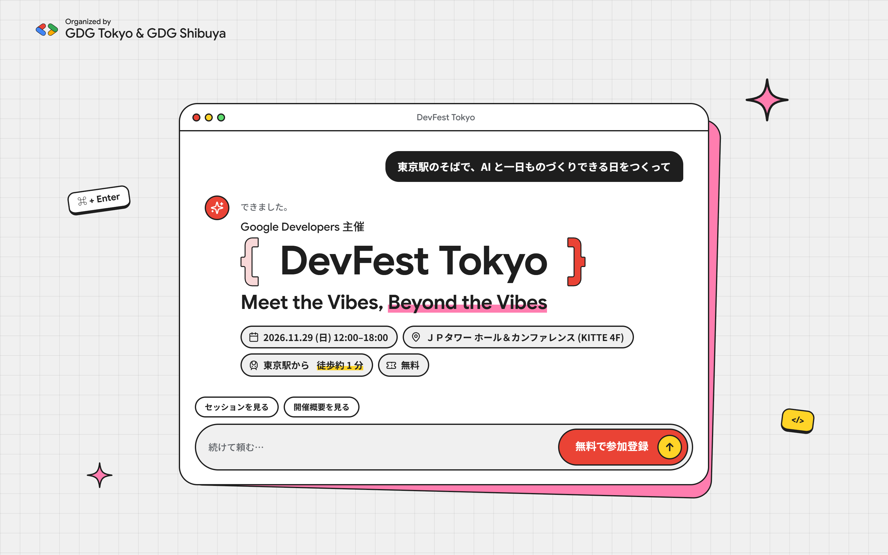
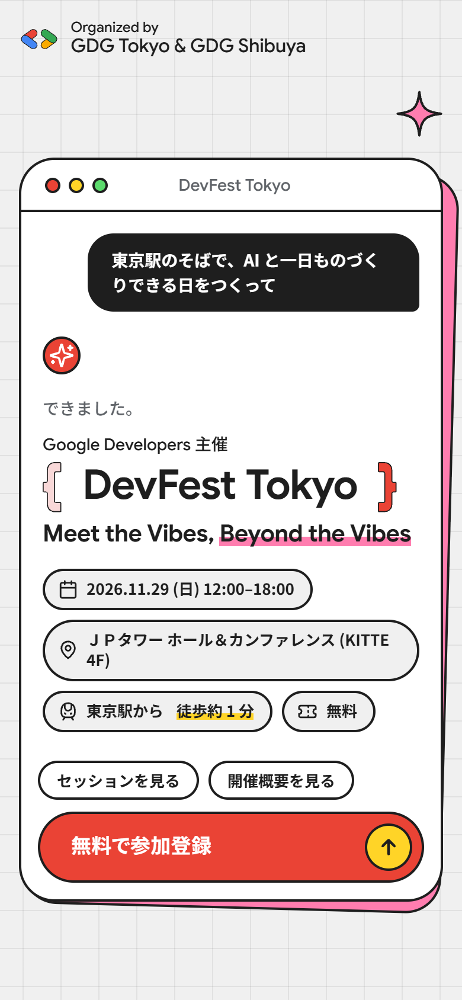
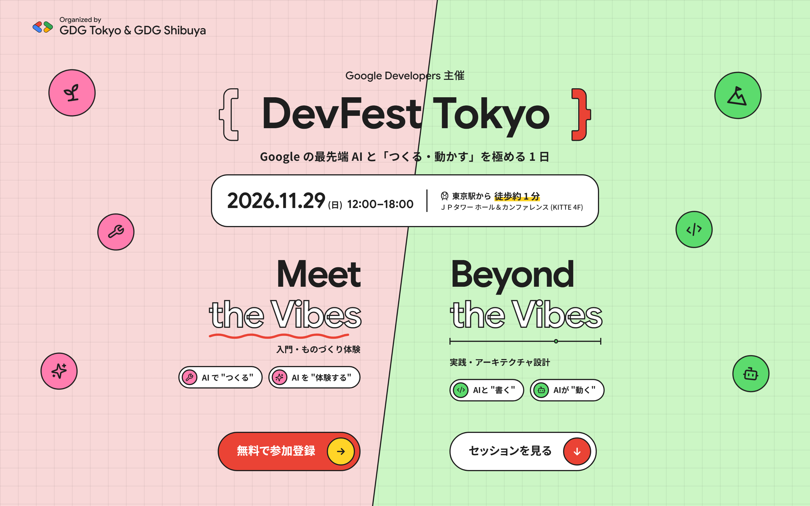
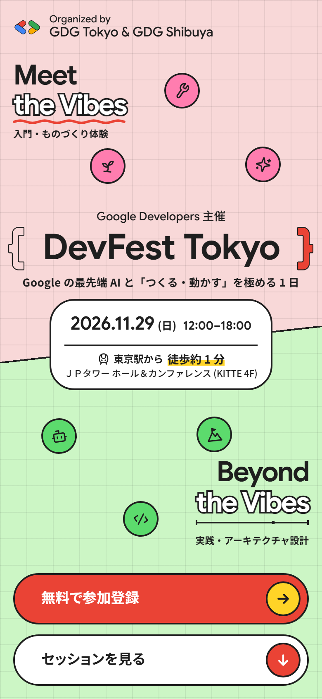
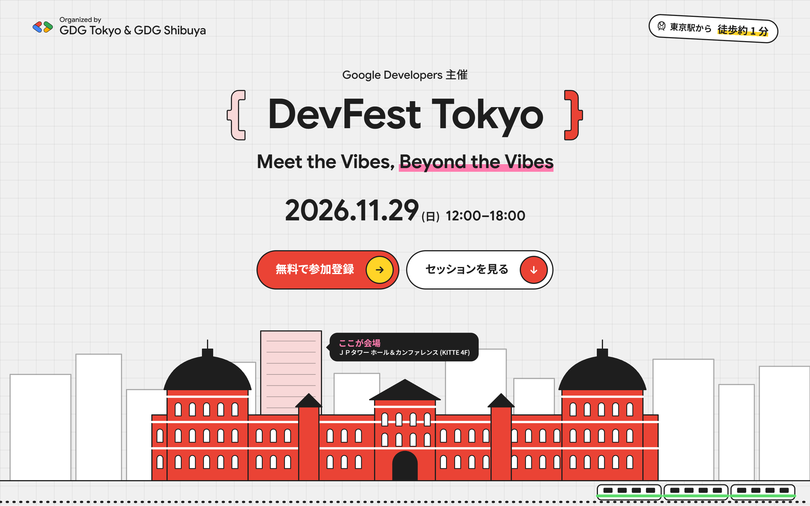
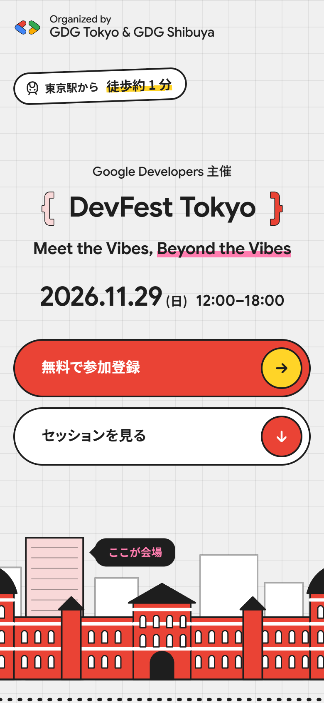

# DevFest Tokyo 2026 キービジュアル（ヒーロー）案

DevFest Tokyo 2026 のトップページのヒーロー（ファーストビュー）として作った 4 案です。
サイトでは **C（Split）** を採用しています。A・B・D はサイトのビルドから外し、資料としてこのフォルダに保管しています。オープニング映像やスライドなど、サイト以外で使う場合の素材としてもどうぞ。

## 画像

`images/` に、PC 版（1440×900）とスマホ版（390×844）を 2 倍の解像度（PC 2880×1800、スマホ 780×1688）で書き出しています。動きのある要素は、アニメーションが終わった状態で撮っています。

| 案                    | PC                                         | スマホ                                     |
| --------------------- | ------------------------------------------ | ------------------------------------------ |
| A — Wave              |          |          |
| B — Prompt            |        |        |
| C — Split（**採用**） |         |         |
| D — Station           |       |       |

## 各案のコンセプト

- **A — Wave**: DevFest Kansai のヒーローと同じ構成（左上に主催、`{ }` の中の文字の打ち替え、日付カード、ボタン 2 つ）を Tokyo の赤で作った案です。`{ }` の中が「DevFest Tokyo → Meet the Vibes → Beyond the Vibes」と打ち替わり、まわりに Vibes を表す線画（波形・レベルメーター・カーソル・吹き出し）が動きます。
- **B — Prompt**: Vibe Coding を AI チャット画面で表した案です。依頼文が打ち込まれ、少し考えてから、返答としてロゴ・テーマ・日時・会場が現れます。入力欄の送信ボタンが参加登録です。
- **C — Split（採用）**: テーマの 2 つ（Meet the Vibes／Beyond the Vibes）を、赤と緑の 2 面に斜めの境目で分けた案です。イベント名・日時・会場を最初に見せ、その下で 2 つのテーマが向かい合います。左右の余白のアイコンは、芽（初心者）・山（中・上級者）と 4 つのカテゴリ（つくる・体験する・書く・動く）です。
- **D — Station**: 会場が東京駅から徒歩約 1 分であることを、絵で伝える案です。赤レンガ・白い帯・黒いドームの東京駅丸の内駅舎を画面の下に描き、後ろに丸の内のビル群と会場ビルのピン、手前に山手線カラーの電車を置いています。

## ファイルの場所

| 内容                     | 場所                                                                         |
| ------------------------ | ---------------------------------------------------------------------------- |
| C（サイトで使用中）      | `src/routes/tokyo/_components/hero/HeroSplit.astro`（部品は同じフォルダ）    |
| A                        | `candidates/HeroWave.astro`、`candidates/brace.ts`                           |
| B                        | `candidates/HeroPrompt.astro`                                                |
| D                        | `candidates/HeroStation.astro`                                               |
| A・B・D だけが使う文言など | `candidates/hero-extras.ts`                                                  |
| 開発中の案の切り替え     | `candidates/HeroSwitch.astro`（開発サーバーで左下に出していた切り替え）      |

`candidates/` の中身は、作ったときのまま保管しています。サイトのビルド・型チェック・lint・書式チェックの対象からは外しています（`tsconfig.json`、`eslint.config.js`、`.prettierignore`）。そのため、このフォルダに置いたままでは動きません。

## A・B・D をサイトでもう一度表示するには

1. 使いたい案のファイルを `src/routes/tokyo/_components/hero/` に戻します（A は `brace.ts` も一緒に戻します）。
2. `candidates/hero-extras.ts` のコメントに従い、文言を `src/routes/tokyo/_content.ts` の `HERO` に、項目を `src/routes/tokyo/_components/hero/facts.ts` の `heroFacts` に戻します。
3. `src/routes/tokyo/_components/Home.astro` で、`HeroSplit` の代わりにその案を読み込みます。

開発中のように複数の案を切り替えて見比べたい場合は、`HeroSwitch.astro` も戻し、Home.astro で候補をすべて描画して `?hero=a` のように選べるようにします。この仕組みは、このフォルダに移す直前のコミット（`c4e88f3`）の `Home.astro` にあります。

## 注意

- A のキャッチコピー「AI とノリでつくる入門から、設計して届ける実践まで。」と、B のチャットの依頼文は、デザイン用に仮で書いた文章です。
- ロゴ（`{ DevFest Tokyo }`）の括弧の色は、セッションの OGP 画像と同じ 2 色（淡い赤 `#f8d8d8` と赤 `#ea4335`）です。
- 色・書体・線の太さなどは、サイトのデザイントークン（`src/styles/tokens.css`、`src/routes/tokyo/_style.css`）に合わせています。
